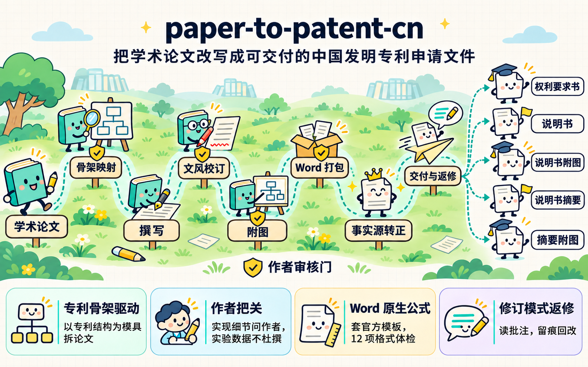

<div align="center">

# paper-to-patent-cn

### 学术论文 → 骨架映射与作者审核 → 中国发明专利申请文件

**将学术论文改写为可交付专利代理机构的五件 Word 申请文件。**

[](#license-and-commercial-use)
[](#安装)

**允许非商业使用。商业使用须事先获得书面授权。**

[功能](#功能) · [快速开始](#快速开始) · [安装](#安装) · [贡献者](#贡献者) · [License](#license-and-commercial-use) · [致谢](#致谢)



</div>

> 本项目是撰写辅助工具，不替代专利代理人。新颖性、创造性、侵权、申请时机等法律判断，本 skill 不下结论。

## 功能

完整流程如下，工作流与日志贯穿全程：

**论文分析与骨架映射 → 撰写 → 文风校订 → 附图 → Word 打包 → 事实源转正 → 交付与返修**

| 流程 | 目的 | 功能 |
|---|---|---|
| 论文分析与骨架映射 | 确定专利的保护范围，避免照搬论文结构 | 以专利结构为模具逐项对应论文内容，产出映射表、剔除清单和权利要求结构；列出不能从论文推断的实现细节，交由作者核实 |
| 撰写 | 使首稿符合 CNIPA 要求和代理机构的审核标准，减少返修 | 依据映射表生成权利要求书、说明书和摘要的全文草案；规范覆盖公式与符号、步骤与数据流、术语一致性、有益效果和实施例写法，并提供交稿前自查表 |
| 文风校订 | 去除首稿的 AI 写作痕迹，同时保证技术内容不变 | 由未参与撰写的 agent 审计并改写，审计同时起到盲审作用；权利要求只报告不改写；校验脚本核对数字、公式、术语和固定句式 |
| 附图 | 保证附图与文字一致，且只有一个可编辑来源 | 以一个 PPT 合集管理全部附图，可基于论文框架图的 PPT 修改；流程图的框与技术方案的步骤一一对应；脚本导出 300 dpi 的 PNG |
| Word 打包 | 产出符合官方格式、公式可编辑的五个标准件 | 以官方模板为底稿生成五件 docx；将 LaTeX 公式转为 Word 原生公式；依次经过 12 项格式体检、独立终审和用户目视验收 |
| 事实源转正与快照 | 防止重新生成覆盖手工修改，并使二进制文件的变更可读 | 验收通过后以 docx 为唯一事实源，不再重新生成；导出只读的 md 快照，随提交入库 |
| 交付与返修 | 依据代理机构的意见回改，并保留全部修订痕迹 | 读取批注和修订，包括批注中嵌入的公式；比对两轮稿件；以 Word 修订模式写入，写入前检查文件锁，写入后做接受和拒绝的双向验证 |
| 工作流与日志（贯穿全程） | 保留可追溯的版本和变更记录 | 按版本目录存放产物；按专利分开记录日志和索引；git 提交前由用户审核 |

适用范围为「方法类论文 → 方法专利」。系统类、装置类需另行调整权利要求布局和附图。外观设计、实用新型、PCT 和外国申请不在范围内。

## 快速开始

安装完成后，在 agent 中打开存放专利文件的目录，以自然语言发起任务。

### 1. 分析论文

```text
使用 paper-to-patent-cn，将 paper/my_paper.pdf 改写为中国发明专利申请文件。
```

Agent 读取论文后，输出映射表、剔除清单和权利要求结构，并列出需要作者核实的实现细节。用户确认前不开始撰写。

### 2. 撰写并校订文风

```text
方案已确认，撰写五件草案，并执行文风校订。
```

产出 `v1/草案.md` 和审计表。审计表列出每处改动和技术疑点，由用户决定取舍。

### 3. 生成附图并打包

```text
草案已确认，生成附图并打包五件 Word。
```

产出 `v1/figures/` 和 `v1/word/`。用户在 Word 中验收通过后，docx 转正为事实源，后续修改都落在 docx 上。

### 4. 处理代理机构返修

```text
代理机构返回了修改意见 revise_v1/修改意见.docx，请逐条处理批注并回改。
```

改动以 Word 修订模式写入，代理机构原有的批注和修订全部保留。

**以下节点必须由用户确认，agent 不自行决定**：映射表和权利要求结构、实现细节的真实写法、实验数据的取舍、文风校订的改动、附图的版面和内容、Word 验收、git 提交。

### 目录与版本更新

```text
<专利短名>/
├── INDEX.md               # 专利名称、来源论文、当前状态、最新日志
├── logs/                  # 每日工作日志
├── paper/                 # 来源论文，不纳入版本体系
├── v1/                    # 成稿阶段：首份生成稿；作者手写的基线稿须冻结
│   ├── 草案.md             # 转正前的事实源，转正后只作存档
│   ├── 论文映射.md          # 映射表，跟随版本
│   ├── figures/           # 附图合集.pptx 和导出的 PNG
│   ├── word/              # 五件 docx，转正后的事实源
│   └── snapshots/         # 只读的 md 快照
├── v2/ v3/ …              # 成稿阶段的后续版本
└── revise_v1/ revise_v2/ … # 修改阶段：每轮代理机构意见一个目录
    ├── …修改意见.docx      # 代理机构返回的原件，只读
    └── …修改稿_v1.docx     # 本轮的工作文件，以修订模式修改
```

版本按以下规则更新：

| 目录 | 何时新建 | 规则 |
|---|---|---|
| `vN`（成稿阶段） | 距上次版本操作超过 24 小时可新建。24 小时内除非用户明确要求，改动落在当前版本；改动量大时由用户决定 | 每版目录保存该版的全部产物 |
| `revise_vN`（修改阶段） | 只有收到代理机构新一轮意见才新建。同一轮内多次修改都落在当前目录 | N 是意见的轮次，不是修改次数。新建时不覆盖上一轮 |

成稿和修改是先后两个阶段。修改阶段开始后，成稿阶段的最后一版冻结存档。

各阶段的规范见 [`references/`](references/)，脚本的用法见 [`scripts/README.md`](scripts/README.md)。

## 安装

### Claude Code

```bash
# 所有项目可用
git clone https://github.com/lancorrect/paper-to-patent-cn.git ~/.claude/skills/paper-to-patent-cn

# 仅当前项目可用
git clone https://github.com/lancorrect/paper-to-patent-cn.git .claude/skills/paper-to-patent-cn
```

### Codex

```bash
# 所有项目可用
git clone https://github.com/lancorrect/paper-to-patent-cn.git ~/.agents/skills/paper-to-patent-cn

# 仅当前项目可用
git clone https://github.com/lancorrect/paper-to-patent-cn.git .agents/skills/paper-to-patent-cn
```

### 配置与依赖

在 skill 目录中复制配置模板并填写：

```bash
cp config.local.md.example config.local.md
```

`config.local.md` 存放本机和个人相关的信息，包括 Word 登录账户名、Python 环境路径、参照样例的位置和代理机构信息。该文件已被 `.gitignore` 忽略，不会入库。

安装 Python 依赖：

```bash
pip install python-docx python-pptx lxml latex2mathml pillow pymupdf numpy
```

部分流程还需要以下软件：

- **Microsoft Word**：目视验收和修订模式返修。
- **Microsoft PowerPoint**：脚本导出 PNG，仅支持 macOS。其他环境可在 PowerPoint 中手工导出。
- **第二个 agent**：文风校订须由未参与撰写的 agent 执行，默认使用 [Codex CLI](https://github.com/openai/codex)。

## 贡献者

- [lancorrect](https://github.com/lancorrect)
- [di-zaiyuan](https://github.com/Di-Zayn)

## License and commercial use

**允许非商业使用。商业使用须事先获得书面授权。**

本项目作者撰写的部分采用 [PolyForm Noncommercial License 1.0.0](LICENSE)。个人学习与研究、教学、非商业学术研究，以及教育机构和公共研究机构的使用，均在许可范围内。企业业务使用、付费服务和集成到商业产品，须先提交[商业授权申请](https://github.com/lancorrect/paper-to-patent-cn/issues/new?title=%E5%95%86%E4%B8%9A%E6%8E%88%E6%9D%83%E7%94%B3%E8%AF%B7)。

文风校订使用 [academic-humanizer](https://github.com/AIScientists-Dev/academic-humanizer)，其 MIT 许可声明见 [`licenses/academic-humanizer-MIT.txt`](licenses/academic-humanizer-MIT.txt)。

## 致谢

感谢 [academic-humanizer](https://github.com/AIScientists-Dev/academic-humanizer)。它基于 [humanizer](https://github.com/blader/humanizer)，并采用了 [ARMS](https://github.com/koaeraser/ARMS) 的标准。
